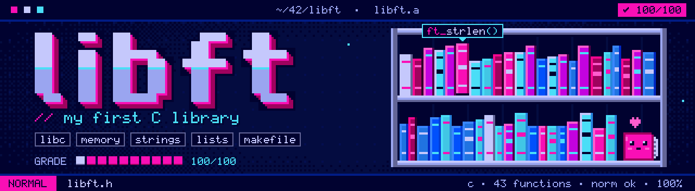

<p align="center"></p>

<div align="center">

# 📚 Libft — 42 Angoulême


<br>


</div>

## 📖 About

**Libft** is the first project of the 42 common core. The goal is to build my own C library from scratch: recode a set of standard **libc** functions, add extra **string and memory** utilities, and handle **singly linked lists**.

The result is a static library, `libft.a`, that I will reuse in all my future 42 projects. Every function follows the **Norminette**, and the whole project was checked by **Moulinette** and by peer evaluations.

---

## 📝 Result

<div align="center">
<table>
  <tr>
    <th>Libft</th>
  </tr>
  <tr>
    <td align="center"></td>
  </tr>
</table>
</div>

---

## 🔤 Part 1: Libc functions

| Function | Description |
|---|---|
| `ft_isalpha` | Checks whether a character is a letter. |
| `ft_isdigit` | Checks whether a character is a digit (`0` to `9`). |
| `ft_isalnum` | Checks whether a character is a letter or a digit. |
| `ft_isascii` | Checks whether a value belongs to the ASCII table (0 to 127). |
| `ft_isprint` | Checks whether a character is printable, space included. |
| `ft_strlen` | Returns the length of a string. |
| `ft_memset` | Fills a memory area with a given byte. |
| `ft_bzero` | Sets a memory area to zero. |
| `ft_memcpy` | Copies `n` bytes between two memory areas that do not overlap. |
| `ft_memmove` | Copies `n` bytes and safely handles overlapping memory areas. |
| `ft_strlcpy` | Copies a string with a size limit and always NUL-terminates the result. |
| `ft_strlcat` | Appends a string to another with a size limit. |
| `ft_toupper` | Converts a lowercase letter to uppercase. |
| `ft_tolower` | Converts an uppercase letter to lowercase. |
| `ft_strchr` | Finds the first occurrence of a character in a string. |
| `ft_strrchr` | Finds the last occurrence of a character in a string. |
| `ft_strncmp` | Compares two strings over at most `n` characters. |
| `ft_memchr` | Searches the first `n` bytes of a memory area for a byte. |
| `ft_memcmp` | Compares two memory areas byte by byte. |
| `ft_strnstr` | Finds a substring within the first `n` characters of a string. |
| `ft_atoi` | Converts a string into an `int`. |
| `ft_calloc` | Allocates memory for an array and fills it with zeros. |
| `ft_strdup` | Returns a newly allocated copy of a string. |

## ➕ Part 2: Additional functions

| Function | Description |
|---|---|
| `ft_substr` | Extracts a substring from a start index and a maximum length. |
| `ft_strjoin` | Joins two strings into a new one. |
| `ft_strtrim` | Removes a set of characters from both ends of a string. |
| `ft_split` | Splits a string into an array of words using a delimiter. |
| `ft_itoa` | Converts an `int` into a newly allocated string. |
| `ft_strmapi` | Applies a function to each character to build a new string. |
| `ft_striteri` | Applies a function to each character of a string, in place. |
| `ft_putchar_fd` | Writes a character to a file descriptor. |
| `ft_putstr_fd` | Writes a string to a file descriptor. |
| `ft_putendl_fd` | Writes a string followed by a newline to a file descriptor. |
| `ft_putnbr_fd` | Writes an integer to a file descriptor. |

## 🔗 Part 3: Linked lists

```c
typedef struct s_list
{
	void			*content;
	struct s_list	*next;
}	t_list;
```

| Function | Description |
|---|---|
| `ft_lstnew` | Creates a new node holding the given content. |
| `ft_lstadd_front` | Adds a node at the beginning of a list. |
| `ft_lstsize` | Counts the number of nodes in a list. |
| `ft_lstlast` | Returns the last node of a list. |
| `ft_lstadd_back` | Adds a node at the end of a list. |
| `ft_lstdelone` | Frees the content of one node with a given function, then frees the node. |
| `ft_lstclear` | Deletes and frees every node of a list. |
| `ft_lstiter` | Applies a function to the content of every node. |
| `ft_lstmap` | Builds a new list by applying a function to the content of every node. |

---

## ⚙️ Usage

```bash
make        # build libft.a
make clean  # remove object files
make fclean # remove object files and libft.a
make re     # rebuild everything
```

Then include the header and link the library in your project:

```c
#include "libft.h"
```

```bash
cc -Wall -Wextra -Werror main.c -L. -lft
```

---

## 🗂️ Repository structure

```
libft/
├── libft.h     # Prototypes and t_list structure
├── ft_*.c      # The 43 functions
├── Makefile    # Builds libft.a
└── assets/     # Banner + grade badge used in this README
```

---

## 🏆 Final words

A big thank you to everyone at 42 Angoulême who reviewed my code, debated edge cases with me and pushed me to test every function until it broke. Writing my own `memmove` and `split` from scratch taught me more about memory than any course ever did. I came out of this project **boosted**, and I really enjoyed it. 💗

If the Piscine was the **Hunter Exam** 🎣, Libft is the moment Gon and Killua learn **Nen** ⚡: back to the fundamentals (Ten, Zetsu, Ren, Hatsu) to build the base that every future technique relies on. Next project, here I come! 🚀

<div align="center">

**Made with ☕, 💗 and a lot of segfaults by [1soka](https://github.com/1soka)**

</div>
